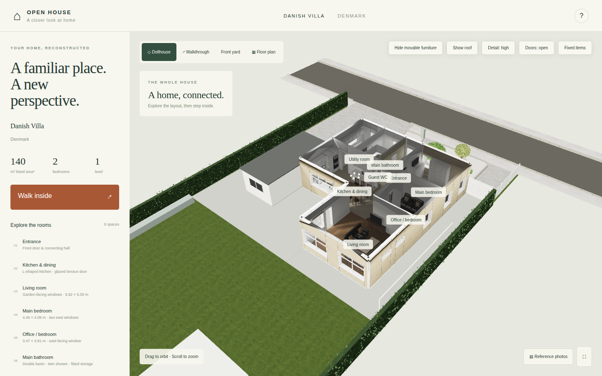
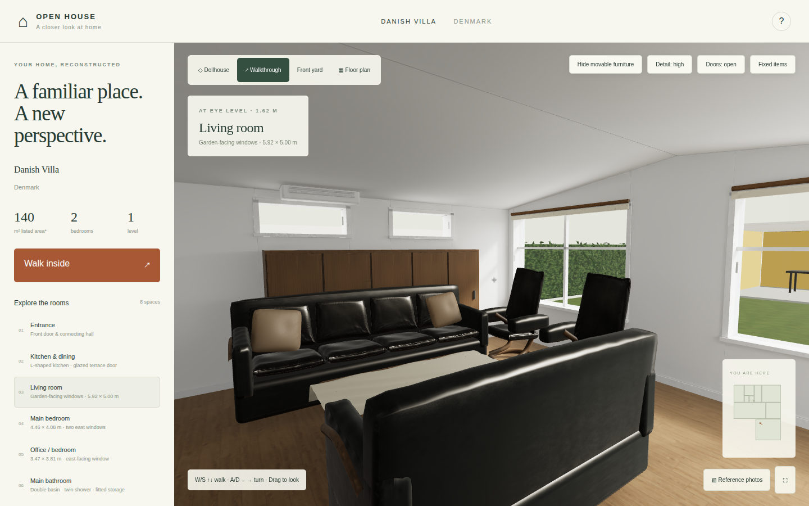
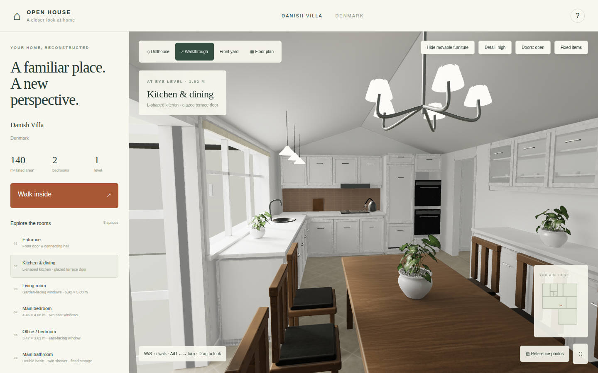
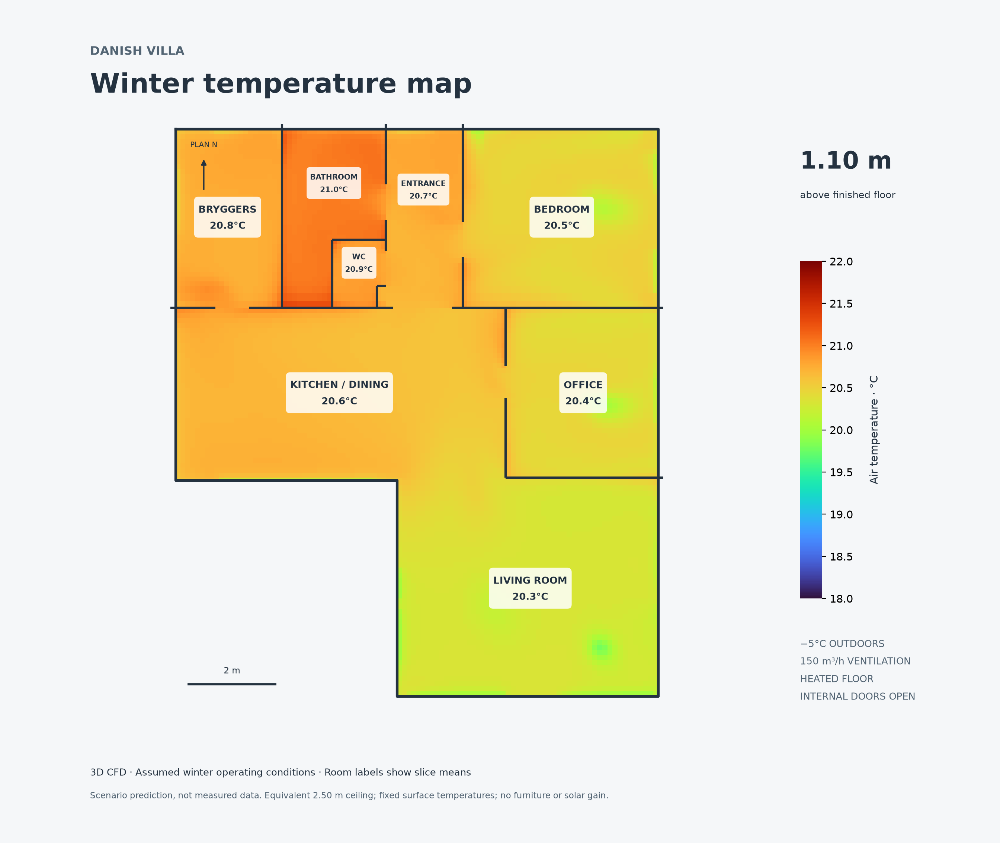

# 3D House Walkthrough and Winter CFD Study

**A 1964 Danish villa rebuilt as a furnished, walkable 3D house from photographs and a floor plan. The project includes GPU-baked lighting, editable Unreal Engine scenes and an OpenFOAM simulation of winter indoor air temperature in the same building.**



| Walkthrough: living room | Walkthrough: kitchen |
|---|---|
|  |  |

**▶ Try it:** download `danish-villa-walkthrough.zip` from the [latest release](../../releases/latest), unzip it and serve the folder with any static server (`python3 -m http.server`), then open it in a browser.

## Highlights

- **Photos and plan to 3D.** Walls, openings, door handing, cabinetry and fixtures are reconstructed from 29 photographs and a calibrated floor plan, in metres. Every dimension is documented with its evidence and uncertainty ([`docs/accuracy.md`](docs/accuracy.md), [`docs/plan-measurements.csv`](docs/plan-measurements.csv)).
- **Offline lighting on a cloud GPU.** The source scene is baked in **Blender/Cycles on a RunPod GPU**, denoised with OIDN, and shipped as RGBM WebP lightmaps with precomputed reflection probes. Visitors get baked-quality lighting in a static Three.js site that needs no server.
- **Unreal Engine 5.** The same source GLB is imported into UE 5.8 (FrontOpen and FrontClosed maps) for editing, scale verification and camera and lighting work.
- **Two door states.** Separately baked open-door and closed-door scenes keep geometry, navigation and lighting consistent in each.
- **Winter HVAC CFD** ([`cfd/`](cfd/)). A 3D buoyant RANS simulation in OpenFOAM 13 (~204k cells) of a −5 °C night with balanced heat-recovery ventilation and floor heating. The results are an interactive temperature map, slice figures and a PDF.
- **Automated verification.** Playwright checks door toggles, the front yard, lightmap encoding, dimension regressions and the mobile layout, and benchmark rendering performance.
- **Reusable agent playbook.** [`docs/house-tour-reference/`](docs/house-tour-reference/) records the whole pipeline as a technical report, a production playbook and an agent `SKILL.md`, so it can be repeated for another property.



**Built with OpenAI Codex**, with Claude Code consulted for review. Codex also provisioned and ran the RunPod GPU work through the RunPod MCP server.

## Pipeline

```text
Photos + floor plan + measurements + owner corrections
                         ↓
Photo-informed geometry, materials and navigation (Three.js, metres)
                         ↓ source GLB + metadata
          ┌──────────────┴───────────────┐
          ↓                              ↓
Unreal Engine 5 on RunPod        Blender/Cycles on RunPod
editable scenes, scale checks    GPU light baking → OIDN denoise
                                         ↓
                          Optimized GLB + RGBM lightmaps
                                         ↓
                          Reflection probes → static website
                         ↓
geometry.json → OpenFOAM 13 case → winter temperature field
```

## Repository layout

```text
app/          Three.js + Vite website source (src/property.js holds the reconstructed house)
pipeline/     Source export, Blender bake/denoise, Unreal scene prep, lightmap optimization, Pod bootstrap
scripts/      Verification, benchmarks, plan calibration, reflection baking, delivery reports
cfd/          OpenFOAM case setup (case/system, case/constant), case builder, post-processing, results
docs/         Accuracy and refinement notes, plus the reusable house-tour playbook and agent skill
renders/      Website screenshots and Blender/Cycles review renders
```

## Run from source

```sh
cd app
npm install
npm run dev        # http://localhost:5175
```

The baked models and lightmaps (~280 MB) are not stored in git. To run the source with full lighting, copy the `models/`, `baked/` and `baked-closed/` folders from the release zip into `app/public/`.

The pipeline and verification scripts were written for the original workspace layout (`properties/<house>/…`) and a RunPod GPU. Read them as a record of the production process, not as one-command tools.

## Privacy

The property's address, the source photographs, the floor-plan image and the listing documents are not included. The photo gallery and floor-plan view are therefore empty, while the 3D house, navigation and lighting work as normal. Parcel outlines are stored in local coordinates only.

> An architectural approximation built for visualization and teaching. It is not a survey or a measured digital twin, and the CFD shows an assumed scenario, not measured temperatures.
